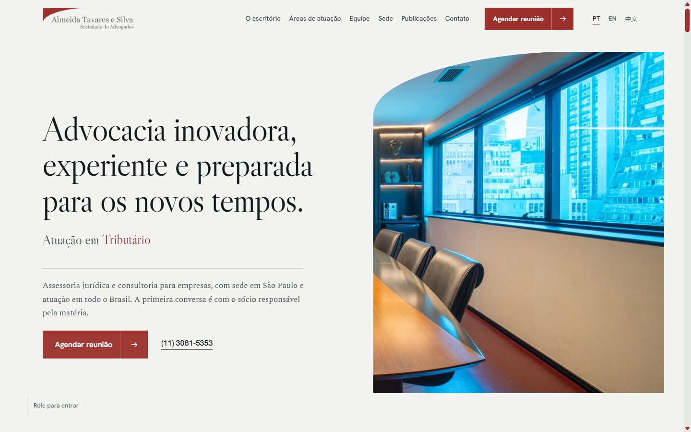
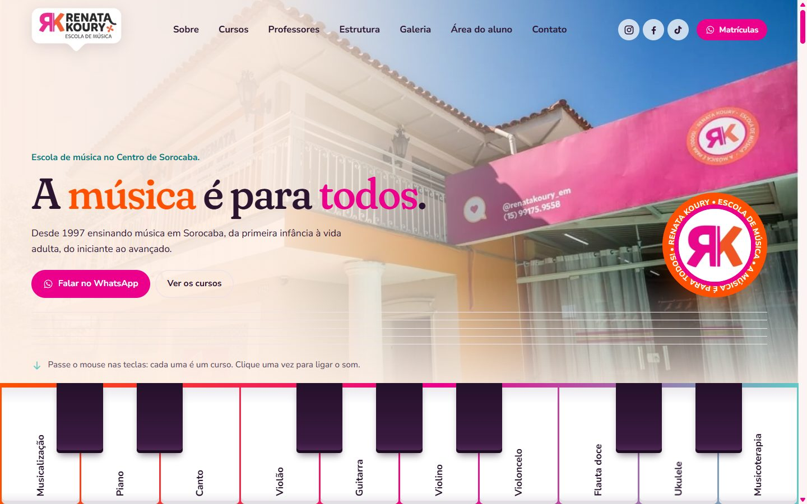
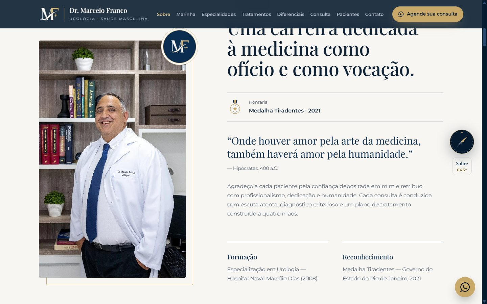
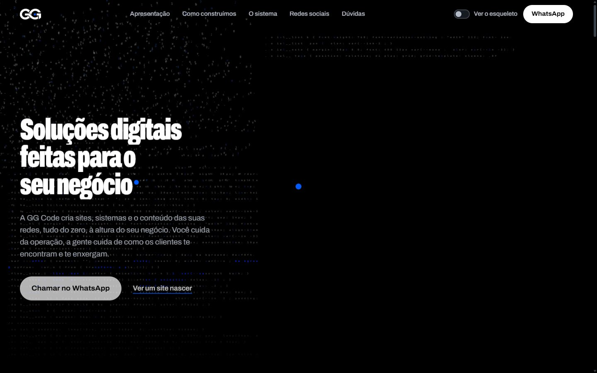

# Sites GG Code

**Portfólio de sites que criei para clientes da GG Code, minha agência de soluções digitais em Sorocaba (SP).**

Cada site parte de uma ideia própria, ligada ao negócio do cliente, em vez de um template. O processo inclui SEO técnico e GEO (otimização para aparecer em respostas de IA), conferidos pela minha [skill de SEO + GEO para Claude Code](https://github.com/guilhermenahass/seo-geo-skill).

| Site | Segmento | Auditoria de SEO (nov/2026) |
|---|---|---|
| [almeidatavares.com](https://www.almeidatavares.com) | Advocacia empresarial, São Paulo | ✅ 0 erros |
| [renatakouryem.com](https://renatakouryem.com) | Escola de música, Sorocaba | ✅ 0 erros |
| [drmarcelofranco.com.br](https://drmarcelofranco.com.br) | Urologista, Rio de Janeiro | ✅ 0 erros |
| [ibanhezservicosind.com](https://ibanhezservicosind.com) | Manutenção industrial, região de Sorocaba | ✅ 0 erros |
| [M4 Cafés](https://darkslateblue-peafowl-131308.hostingersite.com/) | Café especial B2B, Sul de Minas | ✅ 0 erros |
| [ggc0de.com](https://ggc0de.com) | A própria agência | 1 aviso de endereço (agência sem loja física) |

## No ar

### Almeida Tavares e Silva · Sociedade de Advogados
**[almeidatavares.com](https://www.almeidatavares.com)** · escritório de advocacia empresarial em São Paulo

- **Ideia:** sobriedade editorial de escritório tradicional, com a primeira conversa direto com o sócio responsável pela matéria.
- Seção de publicações com artigos e notas técnicas em PDF.
- Versões em português, inglês e chinês.
- Formulário de contato validado no navegador e de novo no servidor.

### Renata Koury Escola de Música
**[renatakouryem.com](https://renatakouryem.com)** · escola de música no Centro de Sorocaba desde 1997

- **Ideia:** um teclado de piano interativo no topo, em que cada tecla é um dos 12 cursos e toca a nota quando o visitante passa o mouse.
- Professores com currículo em painel e área do aluno integrada ao sistema da escola.

### Dr. Marcelo Franco · Urologista
**[drmarcelofranco.com.br](https://drmarcelofranco.com.br)** · consultórios na Barra da Tijuca e em Nova Iguaçu (RJ)

- **Ideia:** uma bússola de navegação acompanha a rolagem e marca cada seção, em referência à carreira do médico na Marinha.
- Redesenho de um site antigo que eu mesmo tinha feito, mantendo 100% do texto do cliente.
- Dados estruturados `Physician` para busca local.

### GG Code
**[ggc0de.com](https://ggc0de.com)** · o site da própria agência

- **Ideia:** "O site se constrói". O código da página aparece sendo escrito no fundo, com animação em three.js, e o botão "Ver o esqueleto" mostra a estrutura por trás do design.

### Ibanhez Serviços Industriais
**[ibanhezservicosind.com](https://ibanhezservicosind.com)** · manutenção industrial, bases de reservatório e içamento de tanques, região de Sorocaba (SP)

- **Ideia:** "Zarcão & Aço", com as cores do primer anticorrosivo e do metal da indústria pesada, e pedido de orçamento direto no WhatsApp.
- Cliente com plano mensal de manutenção.

### M4 Cafés
**[M4 Cafés](https://darkslateblue-peafowl-131308.hostingersite.com/)** · café especial premiado da Fazenda da Onça (Sul de Minas) para cafeterias, padarias e escritórios. O domínio próprio está a caminho.

- **Ideia:** "da fazenda para o seu balcão". O site leva o comprador B2B do cafezal à xícara, passando pelos cafés, pela fazenda, pela história da família e pelos prêmios.
- Orçamento direto no WhatsApp.

## Como trabalho

1. **Briefing e imersão:** reunião com o cliente, levantamento do Instagram, fotos reais e concorrentes.
2. **Conceito:** uma ideia central que só faz sentido para aquele negócio.
3. **Protótipo navegável:** em poucos dias, aprovado em reunião, com rodadas de ajuste.
4. **SEO + GEO:** title, description, canonical, JSON-LD do negócio local, sitemap, robots e Perfil da Empresa no Google, conferidos com o script de auditoria antes de publicar.
5. **Publicação e manutenção:** domínio, SSL e DNS sem mexer no e-mail do cliente, e plano mensal.

Os sites com formulário de contato podem enviar os leads direto para o [GG Code Gestão](https://github.com/guilhermenahass/ggcode-gestao), o sistema de vendas da agência.

## Stack e ferramentas

HTML · CSS · JavaScript · three.js · PHP (formulários) · Hostinger / DNS / SSL · Claude Code · Cursor · Higgsfield e Google Flow (imagens e vídeos com IA) · Google Search Console · Bing Webmaster Tools

---

Sites, textos e imagens pertencem aos respectivos clientes e aparecem aqui com autorização. O código-fonte não é público.
